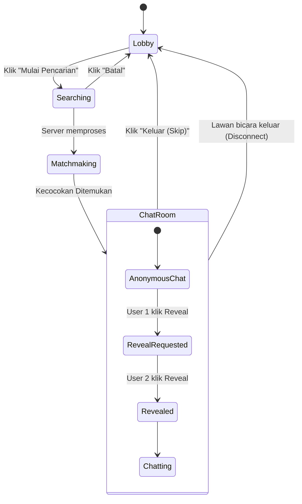

# Appflow: Blind Chat Quizzy 🔄

## Diagram Alur

## Skenario Lengkap (User Journey)
1. User A masuk ke halaman Lobby (`/chat`), memilih cari MBTI "ENFP", lalu klik Cari.
2. User A masuk ke antrean (*Queue*). Animasi Radar berputar.
3. User B (seorang ENFP) masuk ke Lobby, memilih cari "Siapa Saja (Bebas)", lalu klik Cari.
4. Server mencocokkan A dan B. Keduanya otomatis dialihkan ke layar Chat Room (`/chat/room_id_xyz`).
5. A dan B saling mengobrol anonim. Masing-masing hanya melihat avatar default dan tipe MBTI lawannya di header.
6. A merasa obrolan mengalir, lalu menekan tombol "Reveal". Tombol A berubah status menjadi "Menunggu", sementara layar B mendapat pesan sistem *"Lawan memintamu untuk Reveal"*.
7. B setuju dan menekan tombol "Reveal" miliknya. Sistem menembakkan efek *confetti*, lalu foto profil dan nama asli A & B saling terlihat.
8. B bosan atau kelelahan, lalu menekan tombol "Keluar". Chat room ditutup secara permanen di database.
9. A mendapat pesan sistem *"Teman ngobrol telah pergi"*. A langsung dialihkan kembali ke Lobby.
