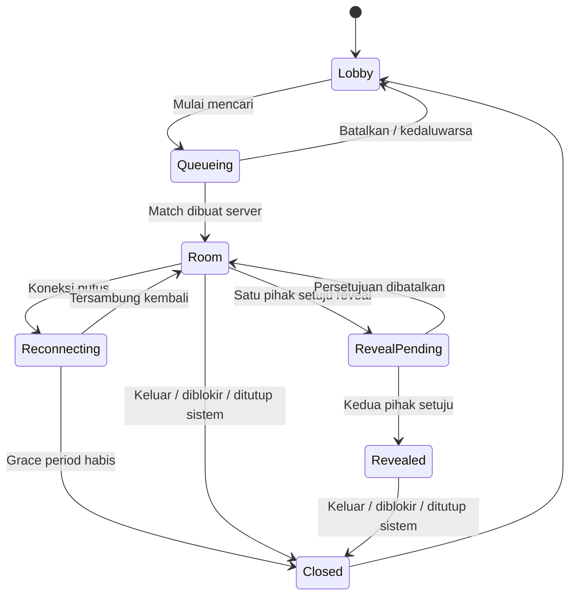

# Blind Chat: alur aplikasi

Status saat ini: layar berikut sudah memiliki prototipe visual, tetapi match dan percakapan masih disimulasikan di browser.

## State utama

## Alur normal

1. User A membuka `/chat`, membaca aturan singkat, lalu memilih target ENFP.
2. Server memvalidasi bahwa A tidak sedang mengantre atau berada di room aktif.
3. A masuk antrean. UI menampilkan durasi pencarian dan tombol batal.
4. User B masuk dengan preferensi yang kompatibel.
5. Server membuat satu room dan dua participant dalam transaksi yang sama.
6. Kedua klien membuka `/chat/:roomId` dan mengambil state room dari server. Reload tidak bergantung pada `location.state`.
7. A dan B bertukar pesan. Keduanya hanya melihat identitas anonim dan tipe MBTI yang memang boleh dibagikan.
8. A memberi consent reveal. B melihat permintaan, tetapi identitas belum terbuka.
9. B memberi consent. Server mulai mengembalikan field profil yang diizinkan kepada keduanya.
10. Salah satu user keluar. Room ditutup dan pengiriman pesan berikutnya ditolak.

## Batalkan pencarian

- Klien mengirim cancel dengan `request_id` terakhir.
- Server mengubah atau menghapus row yang masih `waiting`.
- Jika match sudah dibuat tepat sebelum cancel, server mengembalikan room tersebut; klien tidak boleh menciptakan state ambigu “batal tetapi room aktif”.

## Reload dan direct URL

- `/chat/:roomId` selalu mengambil room berdasarkan session user.
- Non-participant menerima not found/forbidden tanpa metadata lawan bicara.
- Room tertutup menampilkan alasan umum dan tombol kembali ke lobby.
- Data identitas tidak diambil dari fallback hard-coded.

## Disconnect

- Putus WebSocket memulai grace period, bukan langsung menutup room.
- Partner melihat status “mencoba menyambung kembali”, bukan klaim bahwa user sudah pergi.
- Jika user kembali dalam grace period, room dilanjutkan.
- Setelah grace period, server menutup room dan memberi event ke partner.

## Block dan report

- Block menutup room, mencegah match berikutnya, dan tidak memberi tahu akun yang diblokir tentang identitas pelapor.
- Report meminta alasan terstruktur dan detail opsional.
- UI menjelaskan data apa yang disertakan sebagai bukti.
- Report tidak otomatis dianggap terbukti; status review ditangani moderator.
